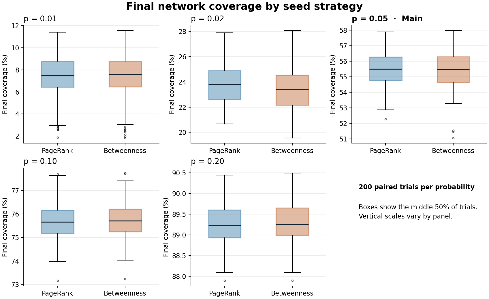
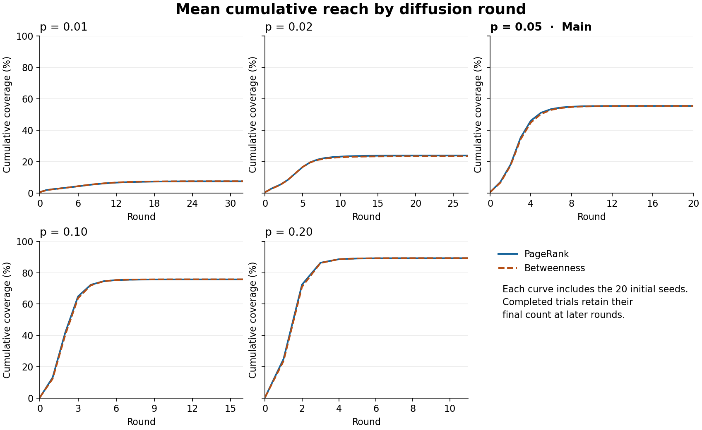

# Seed Selection and Information Diffusion

RQ1 asks whether PageRank or betweenness centrality selects more effective seeds for information diffusion on the SNAP Facebook network. Under the primary setting of `p = 0.05`, the two strategies each reached about 55% of the network. The paired estimate was 1.85 additional activations for PageRank (95% CI −0.22 to 3.91 nodes), so the primary comparison did not establish a clear advantage for either strategy.

## Independent cascade and experimental design

We used the original undirected, unweighted SNAP Facebook graph with 4,039 nodes and 88,234 edges. Each strategy activated its 20 highest-ranked nodes at round 0. PageRank used damping 0.85 and tolerance `1e-8`, and betweenness was exact, normalized, and excluded endpoints. Ties were broken by ascending node ID. The two seed sets shared 10 nodes. The formal run used the repository's [raw edge list](../data/raw/facebook_combined.txt.gz) and [published exact centrality rankings](../pilot/centrality_scores.csv) because the team’s shared root-level edge and centrality CSV files were not yet available. [SNAP dataset](https://snap.stanford.edu/data/egonets-Facebook.html)

After Member A uploaded the shared CSVs, we checked the complete node and undirected edge sets against the inputs used for this experiment. All 4,039 nodes and 88,234 edges matched exactly, and both PageRank and betweenness Top-20 lists matched in membership and order. The script loaded Member A's files successfully and produced identical canonical directed-edge arrays and seed sets. This confirms that the existing 2,000-cascade results are consistent with the team's shared inputs. [Member A's edge table](../facebook_edges.csv) · [Member A's centrality table](../centrality_scores.csv)

For each of 200 trials at every probability, we generated one independent uniform draw for each direction of every edge using PCG64 with seed `602900 + Trial_ID`. A direction was available if its draw fell below `p`. The two seed strategies used the same draws within each pair, and the draws were reused at different probabilities for the same trial ID. We used the shared live-edge implementation to find nodes reachable from either seed set and their first activation round. Coverage includes the initial seeds and uses the original node count as its denominator. The five probabilities yielded 1,000 pairs and 2,000 cascades. [Final experiment protocol](../Final_Experiment_Protocol.md) · [IC implementation](../ic_core.py)

## Results

The table reports mean and sample SD in activated nodes. We calculated the two-sided 95% t interval from the 200 within-trial differences at each probability. Differences are PageRank minus betweenness. Intervals for the sensitivity settings are pointwise.

| Probability | PageRank, mean ± SD | Betweenness, mean ± SD | Paired mean difference | 95% CI, nodes |
|---:|---:|---:|---:|---:|
| 0.01 | 298.54 ± 76.30 | 300.85 ± 75.46 | −2.32 | [−8.39, 3.76] |
| 0.02 | 962.73 ± 63.27 | 944.70 ± 65.34 | +18.03 | [15.42, 20.64] |
| **0.05 (primary)** | **2,240.17 ± 43.90** | **2,238.33 ± 47.56** | **+1.85** | **[−0.22, 3.91]** |
| 0.10 | 3,057.45 ± 29.05 | 3,059.95 ± 29.21 | −2.50 | [−2.72, −2.27] |
| 0.20 | 3,603.87 ± 20.23 | 3,605.35 ± 20.24 | −1.49 | [−1.69, −1.28] |

At the primary probability, PageRank reached 55.46% of nodes and betweenness reached 55.42%, a difference of 0.046 percentage points. PageRank had its largest advantage at `p = 0.02`, with 18.03 additional nodes, equivalent to 0.446 percentage points of network coverage. At `p = 0.10` and `p = 0.20`, betweenness had a small advantage of fewer than three nodes on average. The change in direction across probabilities and the small differences in coverage show that the seed rankings do not have a consistent ordering across settings.

*Figure 1. Final coverage by probability and seed strategy. The vertical scale varies by panel to show each distribution.*

*Figure 2. Mean cumulative coverage by round. Each completed cascade retains its final count in the average at subsequent rounds.*

The mean curves for the two strategies largely overlap. Higher probabilities produce faster growth and higher final coverage, from about 7.4% at `p = 0.01` to about 89.2% at `p = 0.20`. The intervals quantify Monte Carlo uncertainty for these fixed seed lists on one graph. They do not measure variation across other networks or observed Facebook sharing behavior.

Run `python seed_diffusion.py` from the repository root to reproduce the CSVs and figures. The run used Python 3.12.7, NetworkX 3.3, NumPy 1.26.4, SciPy 1.16.3, and Matplotlib 3.9.2. The script uses the shared CSV inputs when present and otherwise uses the published edge list and rankings above. [Analysis script](../seed_diffusion.py) · [Trial data](../seed_diffusion_trials.csv) · [Statistical summary](../seed_diffusion_summary.csv)
